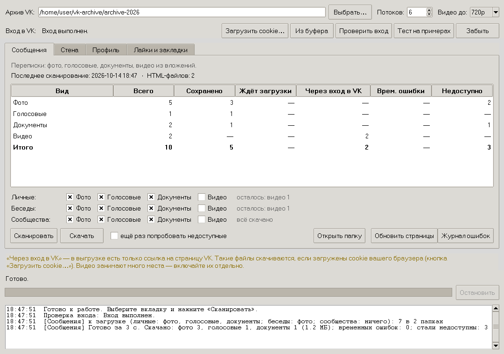

# VK Archive Saver

Программа сохраняет на ваш компьютер фотографии, голосовые сообщения, документы и
видео из **архива данных ВКонтакте** и встраивает их прямо в HTML-страницы архива.

В архиве, который выдаёт VK, медиафайлов нет: вместо них ссылки на серверы VK. Часть
этих ссылок со временем перестаёт работать, а часть ведёт на страницы, которые
открываются только после входа в аккаунт. После обработки программой архив
становится самодостаточным:

* фото показываются картинками прямо в переписках, на стене и в альбомах;
* голосовые сообщения проигрываются встроенным плеером;
* видео открываются во встроенном плеере, документы — по ссылке на локальный файл;
* всё работает без интернета, в любом браузере.

Нужен только **Python 3.8+**, сторонние библиотеки не требуются. Работает на
**Windows, Linux и macOS**. Есть окно программы (tkinter) и командная строка.

---

## Содержание

1. [Что понадобится](#что-понадобится)
2. [Установка](#установка)
3. [Запуск](#запуск)
4. [Как пользоваться](#как-пользоваться)
5. [Вход в VK по cookie](#вход-в-vk-по-cookie)
6. [Командная строка](#командная-строка)
7. [Что программа меняет в архиве](#что-программа-меняет-в-архиве)
8. [Почему не скачалось](#почему-не-скачалось)
9. [Безопасность и приватность](#безопасность-и-приватность)
10. [Разработка](#разработка)
11. [Лицензия](#лицензия)

---

## Что понадобится

1. **Архив VK.** Его запрашивают на странице «Защита данных» в VK
   (`vk.com/data_protection`, раздел о правилах → «Запросить архив»). Выберите нужные
   категории данных, дождитесь письма и распакуйте полученный zip. В распакованной
   папке должны лежать `index.html` и папка `messages`.
2. **Python 3.8 или новее.**
   * **Windows**: установщик с [python.org](https://www.python.org/downloads/), в нём уже
     есть всё нужное, включая tkinter.
   * **macOS**: установщик с python.org (рекомендуется) или Homebrew
     (`brew install python python-tk`).
   * **Linux**: Python обычно уже есть. Для окна программы нужен пакет tkinter:
     `sudo apt install python3-tk` (Debian/Ubuntu), `sudo dnf install python3-tkinter`
     (Fedora), `sudo pacman -S tk` (Arch).
3. **Для фото, документов и видео, которые в архиве есть только как ссылки на
   страницы VK**: браузер, в котором вы вошли в VK, и расширение для экспорта cookie
   (например, Cookie-Editor). Подробнее — в разделе [Вход в VK по cookie](#вход-в-vk-по-cookie).

## Установка

Скачайте проект: кнопка **Code → Download ZIP** на GitHub или

```sh
git clone https://github.com/<автор>/vk-archive-saver.git
```

Удобнее всего положить папку проекта **рядом** с папкой архива: тогда программа
найдёт архив сама при первом запуске.

```
vk-archive/
├── archive-2026/          ← распакованный архив VK (index.html, messages/, …)
└── vk-archive-saver/      ← эта программа
```

Архив можно держать где угодно: путь выбирается в окне программы кнопкой
«Выбрать…» или задаётся параметром `--archive`.

## Запуск

| Система | Окно программы | Командная строка |
|---------|----------------|------------------|
| Windows | двойной щелчок по `VK Archive Saver.pyw` или `vksaver.bat` | `vksaver.bat scan all` |
| Linux   | `./vksaver.sh` (или `sh vksaver.sh`) | `./vksaver.sh scan all` |
| macOS   | двойной щелчок по `VK Archive Saver.command` или `./vksaver.sh` в Терминале | `./vksaver.sh scan all` |
| любая   | `python3 -m vksaver` из папки проекта | `python3 -m vksaver scan all` |

Если на Linux/macOS скрипт не запускается двойным щелчком или командой `./…`, дайте ему
право на запуск: `chmod +x vksaver.sh "VK Archive Saver.command"`.

При первом запуске используются настройки по умолчанию: 6 потоков, видео до 720p,
видео не скачивается, пока вы сами его не включите. Настройки и cookie сохраняются
в папке проекта (`settings.json`, `vk_cookies.json`). Эти файлы не попадают в git.

## Как пользоваться



**1. Сканирование.** Выберите вкладку и нажмите «Сканировать». Программа прочитает
HTML-страницы архива и посчитает медиа-ссылки. Повторное сканирование читает только
изменившиеся файлы.

| Вкладка | Что в ней | Что можно скачать |
|---------|-----------|-------------------|
| **Сообщения** | переписки (`messages/`) | фото, голосовые, документы, видео |
| **Стена** | записи и комментарии, включая репосты (`wall/`) | фото, документы, видео |
| **Профиль** | фотоальбомы, документы, аватар, видеоальбомы (`photos/`, `profile/`, `video/`) | фото, документы, видео |
| **Лайки и закладки** | чужие материалы, которым вы ставили «Нравится» (`likes/`, `bookmarks/`) | фото, документы, видео |

**2. Статистика.** Таблица в каждой вкладке показывает по видам файлов:

* **Сохранено** — файл уже лежит рядом со страницей и встроен в неё;
* **Ждёт загрузки** — есть прямая ссылка на файл;
* **Через вход в VK** — в архиве только ссылка на страницу VK, нужен вход по cookie;
* **Врем. ошибки** — не скачалось из-за сети или сбоя VK, повторится при следующей
  загрузке. После двух неудачных запусков подряд ссылка считается недоступной;
* **Недоступно** — VK ответил окончательно: файл удалён, закрыт, внешний (YouTube) и т. п.

**3. Выбор, что качать.** Галочки «Фото / Голосовые / Документы / Видео». На вкладке
«Сообщения» их три строки: **личные переписки**, **беседы** и **сообщества**. Например,
видео можно качать только из личных переписок. Рядом показано, сколько файлов в
каждой строке ещё не скачано. Максимальное качество видео выбирается вверху
(«Видео до»): видео в 1080p и выше могут весить больше гигабайта.

**4. Загрузка.** Кнопка «Скачать». Её можно остановить в любой момент: скачанное
сохраняется, а следующий запуск продолжит с того же места. Галочка «ещё раз
попробовать недоступные» заново проверяет ссылки из столбца «Недоступно».

**5. Прочие кнопки:**
* «Обновить страницы» — вернуть исходные HTML раздела из резервных копий и заново
  встроить всё уже скачанное, ничего не скачивая;
* «Журнал ошибок» — подробный список того, что не скачалось и почему;
* «Открыть папку» — папка раздела в архиве.

## Вход в VK по cookie

Для части файлов в архиве есть только ссылка на страницу VK (`vk.ru/doc…`,
`vk.ru/photo…`, `vk.ru/video…`). Чтобы их скачать, программа использует вашу сессию
браузера:

1. Откройте vk.ru в браузере, где вы вошли в аккаунт.
2. В Cookie-Editor нажмите **Export → JSON** (cookie скопируются в буфер обмена).
3. В программе нажмите **«Из буфера»**. Можно и **«Загрузить cookie…»**, если сохранили
   их в файл. Подходят JSON, `cookies.txt` (Netscape) и строка `name=value; …`.
4. Нажмите **«Проверить вход»**, затем **«Тест на примерах»**. Тест пробует по 3
   ссылки каждого вида и ничего не сохраняет в архив. Отчёт пишется в
   `<архив>/_vksaver/debug/`.

Как это работает:
* **вложения из переписок** — программа запрашивает сами сообщения через API
  веб-версии VK (`messages.getById`) с тем же временным токеном, который vk.ru
  выдаёт браузеру. Вложения приходят вместе с ключами доступа: без них VK не отдаёт
  чужие документы и фото из переписок;
* **записи и комментарии стены** — так же, через `wall.getById` и
  `wall.getComment`, включая вложения репостов;
* **фото и видео по прямым ссылкам на страницы** (лайки, видеоальбомы) — через
  `photos.getById` и `video.get`, а если не вышло, то со страницы VK;
* **документы** — со страницы документа.

Если VK покажет страницу входа или капчу, загрузка остановится сама, и ничего не
будет помечено как недоступное. Загрузите свежие cookie или сделайте паузу.

## Командная строка

```sh
python3 -m vksaver                                # окно программы
python3 -m vksaver scan all                       # сканировать все разделы
python3 -m vksaver stats all                      # статистика из кэша
python3 -m vksaver download messages              # скачать всё из переписок
python3 -m vksaver download messages --kinds video --chats personal --video-quality 720
python3 -m vksaver download profile --kinds photo,doc --retry-failed
python3 -m vksaver rebuild likes                  # пересобрать страницы раздела
python3 -m vksaver cookies cookies.json           # загрузить cookie и проверить вход
python3 -m vksaver login                          # проверить вход
python3 -m vksaver probe                          # тест на примерах
python3 -m vksaver logout                         # удалить сохранённые cookie
```

* Разделы: `messages`, `wall`, `profile`, `likes`, `all`.
* Виды (`--kinds`): `photo`, `voice`, `doc`, `video`.
* `--chats` (только для сообщений): `personal`, `group`, `community`.
* Другие параметры: `--archive ПУТЬ`, `--workers N`, `--full` (сканировать без кэша).

На Windows вместо `python3 -m vksaver` можно писать `vksaver.bat`, на Linux/macOS
`./vksaver.sh`.

## Что программа меняет в архиве

* Файлы кладутся в подпапки рядом со страницей, где они встречаются:
  `messages/<id>/photos/`, `…/voice/`, `…/docs/`, `…/video/`, `wall/photos/`,
  `photos/photo-albums/photos/` и т. д. В каждой подпапке лежит `_index.json`
  (ссылка → имя файла).
* Ссылки в HTML заменяются локальными файлами: фото становится картинкой, голосовое —
  плеером, видео — плеером со ссылкой на скачивание. Если в архиве у ссылки была
  подпись (лайки, документы профиля, видеоальбомы), исходная ссылка на VK остаётся
  под файлом.
* **Перед первым изменением каждая страница копируется в `<архив>/_backup_html/`**
  с сохранением пути. Исходный вид всегда можно вернуть.
* Служебные данные: `<архив>/_vksaver/` (кэш сканирования, журналы ошибок, отладка);
  `_media_failed.json` и `_media_retry.json` рядом со страницами (недоступные ссылки и
  временные ошибки).

## Почему не скачалось

| Сообщение | Что значит |
|-----------|------------|
| `сообщение удалено или недоступно`, `вложение удалено` | сообщение или вложение удалено в VK |
| `HTTP 404`, `HTTP 424` | файла на серверах VK больше нет |
| `нет доступа к фото (Access denied)` | закрытый альбом или удалённое фото |
| `Доступ ограничен`, `Видеозапись недоступна` | видео закрыто владельцем или удалено |
| `внешнее видео (YouTube…)` | видео с другого сайта, в VK его нет |
| `временно …` | сеть или сбой VK — запустите загрузку ещё раз |
| `не распознано` | VK изменил страницу; копия сохранена в `_vksaver/debug/`, можно приложить к issue (сначала проверьте, что в ней нет ваших личных данных) |

## Безопасность и приватность

* Программа работает **только на вашем компьютере**. Никаких серверов, кроме VK, она
  не использует.
* **Cookie дают полный доступ к вашему аккаунту.** Они хранятся только в
  `vk_cookies.json` в папке проекта и отправляются только на домены vk.ru. На
  серверы с файлами они не уходят. Не пересылайте этот файл и не вставляйте cookie в
  чаты. Кнопка «Забыть» удаляет его. Файл перечислен в `.gitignore`.
* Токен веб-версии VK живёт только в памяти. В журналах и отладочных файлах он
  вырезается.
* В отладочных копиях страниц (`_vksaver/debug/`) могут быть ваши личные данные.
  Не публикуйте их, не проверив содержимое.

## Разработка

```
VK Archive Saver.pyw       окно программы (Windows)
VK Archive Saver.command   окно программы (macOS, двойной щелчок)
vksaver.bat / vksaver.sh   запуск на Windows / Linux и macOS
vksaver/
  sections.py   разделы (вкладки), категории переписок
  common.py     виды медиа и классификация ссылок
  htmlmedia.py  поиск ссылок в HTML и встраивание файлов
  engine.py     сканирование, статистика, загрузка, пересборка страниц
  downloader.py загрузка потоком, проверка содержимого, повторы
  resolvers.py  страница VK -> файл (документы, фото, видео)
  vkapi.py      API веб-версии VK (токен со страницы, messages/wall/photos/video)
  vkauth.py     cookie: импорт, хранение, сессия, проверка входа
  store.py      состояние папки (_index.json, _media_failed.json, …)
  config.py     настройки, поиск архива при первом запуске
  gui.py        окно на tkinter
  __main__.py   командная строка
tests/
  fakevk.py        имитация VK (без сети)
  test_vksaver.py  тесты на выдуманном архиве
```

Тесты не ходят в сеть и не требуют аккаунта VK:

```sh
python3 -m unittest discover -s tests -v
```

Подробности об устройстве проекта, принятых решениях и правилах для доработки
(в том числе с помощью ИИ-ассистентов) — в [AGENTS.md](AGENTS.md). История изменений
— в [CHANGELOG.md](CHANGELOG.md).

## Лицензия

[MIT](LICENSE): можно свободно использовать, изменять и распространять с сохранением
уведомления об авторских правах.

Программа не связана с VK и не одобрена им. Используйте её только для своих данных.
